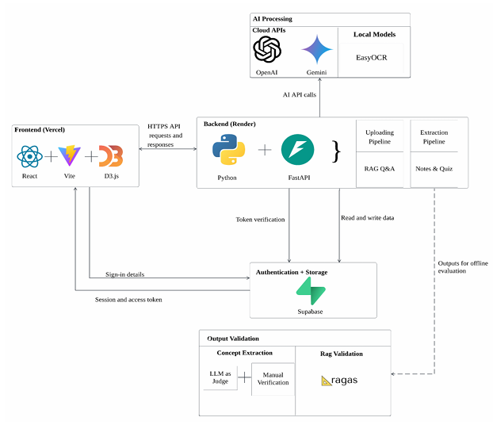

# How StudyGraph works

StudyGraph turns a student's course documents into a source-grounded concept graph and study
materials. The React app is the user interface, the FastAPI service handles application workflows,
OpenAI models process and generate content, and Supabase provides authentication and persistent
storage.

## From documents to a graph

1. **Organize a graph.** A student signs in and creates a subject and graph in the app. Supabase
   authenticates the user, and the backend checks that requests belong to that user.
2. **Upload course materials.** The app sends supported documents to the backend. The backend
   extracts their text and page numbers, splits the text into chunks, creates embeddings, and stores
   the documents and chunks in Supabase.
3. **Build a graph version.** The student selects uploaded documents to process. The backend sends
   chunk batches to an OpenAI model to identify concepts and relationships, combines duplicate or
   overlapping concepts, and saves a versioned graph with links back to supporting documents,
   chunks, and pages.
4. **Explore and study.** The app loads graph versions and provenance to show concepts, connections,
   source material, and changes over time.

## Study tools

- **Ask StudyGraph:** The backend retrieves relevant text chunks for a question, combines them with
  graph relationships when available, and asks the language model to answer from that context with
  citations.
- **Revision notes:** The backend creates notes and study plans from the selected graph's source
  materials. Students can track progress through note sections.
- **Quizzes:** Questions are generated from graph concepts. Quiz answers and progress are saved so
  students can continue later.

## Main components

- `src/` contains the React interface, authentication flow, and API clients.
- `backend/api/` contains the FastAPI routes for documents, graphs, questions, notes, and quizzes.
- `backend/services/` contains document processing, graph generation, retrieval, and study-tool
  logic.
- Supabase provides sign-in, database persistence, and document storage.
- OpenAI models power concept and relationship extraction, embeddings, question answering, notes,
  and quiz generation.

For local installation and environment configuration, see [SETUP.md](SETUP.md).
